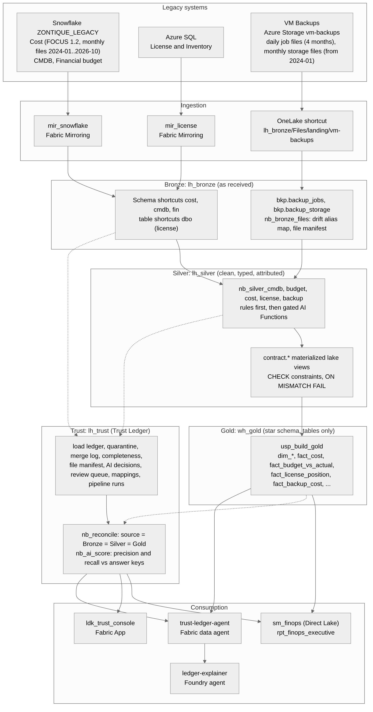

# Legacy Defuse Kit

**AI-Accelerated Legacy-to-Fabric Modernization Factory**, team **de_dust2**. Zontique Corp's cost, CMDB, budget, license and backup data move out of five legacy systems into Microsoft Fabric, are cleaned with rules and gated AI, and a Trust Ledger proves that nothing was lost.

## Results

| Check | Result |
|---|---|
| Reconciliation (source = Bronze = Silver + quarantined + merged = Gold, rows and amounts, 9 entities) | 35 / 35 PASS |
| Effective cost vs answer key | $2,581,544.80, matches to the cent (the legacy report showed $1.90M) |
| Unallocated cost vs answer key | Matches in 33 of 34 months; Sep 2026 differs by $9.47 (attributed by CMDB scope where the key leaves it unallocated) |
| Pipeline `one_pipeline_to_rule_them_all` | Daily, green; every run audited in `meta_pipeline_runs` |

## What runs where

| Layer | Fabric item | Notes |
|---|---|---|
| Sources | `mir_snowflake`, `mir_license`, OneLake shortcut to `vm-backups` | Mirroring, no copy code |
| Bronze | `lh_bronze` | As received; backup files loaded by `nb_bronze_files` |
| Silver | `lh_silver`, `nb_silver_*`, `nb_silver_contract` | Rules first, then gated AI Functions; nothing dropped silently |
| Gold | `wh_gold`, `usp_build_gold` | Star schema, tables only |
| Trust | `lh_trust`, `nb_reconcile`, `nb_ai_score`, `nb_run_audit` | The Trust Ledger |
| Consumption | `sm_finops` (Direct Lake), `rpt_finops_executive`, Fabric App `ldk_trust_console`, data agent `trust-ledger-agent`, Foundry agent `ledger-explainer` | Read-only, signed-in user's own access |
| Governance | Purview (`datatrace`), sensitivity labels, endorsements | Domain *Legacy Defuse Kit*: 8 glossary terms, 2 data products |

Details: [docs/architecture.md](docs/architecture.md) (as built, incl. *Blueprint vs as built*) · [docs/trust-ledger-contract.md](docs/trust-ledger-contract.md) · [docs/foundry-ledger-explainer.md](docs/foundry-ledger-explainer.md).

## Repository

| Path | Content |
|---|---|
| `fabric/` | Fabric workspace `ldk-workspace`, Git-synced. Folders `00_legacy` to `06_intelligence`; the pipeline `one_pipeline_to_rule_them_all` is `pl_ldk_end_to_end.DataPipeline` (renamed in Fabric, folder name kept) |
| `apps/ldk_trust_console/` | Fabric App (React, Rayfin) for pipeline and Trust Ledger monitoring |
| `sql/wh_gold/` | Gold build procedure `usp_build_gold` (same logic as the warehouse copy under `fabric/04_gold`) |
| `generators/generate_zontique.py` | Creates the five legacy systems with planted defects (seed 42) |
| `legacy/snowflake/zontique_legacy.sql` | Builds the Snowflake legacy database `ZONTIQUE_LEGACY` (cost, CMDB, budget) and its legacy views |
| `answer-keys/` | Ground truth, used only for scoring by `nb_ai_score` (see its README) |
| `docs/` | Architecture (as built), Trust Ledger contract, Foundry agent setup, blueprint and SAD (the submitted plan), data catalog (`docs/data-generation/README.md`), diagrams |
| `data/generated/` | Generated data files, not committed |

## Rebuild the legacy world

1. `python generators/generate_zontique.py data/generated`
2. Snowflake: run `legacy/snowflake/zontique_legacy.sql` part by part; upload `data/generated/snowflake/` files when the script says so.
3. Azure SQL: run `data/generated/azure_sql/license_load.sql` (pause the license mirror first).
4. VM Backups: upload `data/generated/vm_backups/` (`jobs/`, `storage/`) to the storage account container `vm-backups`; `lh_bronze` reads it through the OneLake shortcut `Files/landing/vm-backups`.
5. Fabric: re-create the Snowflake mirror, then run the pipeline `one_pipeline_to_rule_them_all`.
6. App: from `apps/ldk_trust_console`, run `npm install`, then `npx rayfin up` (Windows: `npm.cmd` / `npx.cmd`).

## Security

- No secrets in this repo. The Snowflake reader password is in Azure Key Vault `kv-ldk-2446996` (secret `snowflake-ledger-reader-pwd`) and read at run time with `notebookutils.credentials.getSecret`.
- Read-only service users: `LEDGER_READER` (reconciliation), `PURVIEW_SCAN` (catalog scan, role `PURVIEW_SCAN_ROLE` with `SNOWFLAKE.OBJECT_VIEWER`).
- Owner names and emails are hashed in Silver and never sent to AI.
- The app and both agents run as the signed-in user (delegated / On-Behalf-Of). Share the report and app per item; viewers don't need workspace access.
