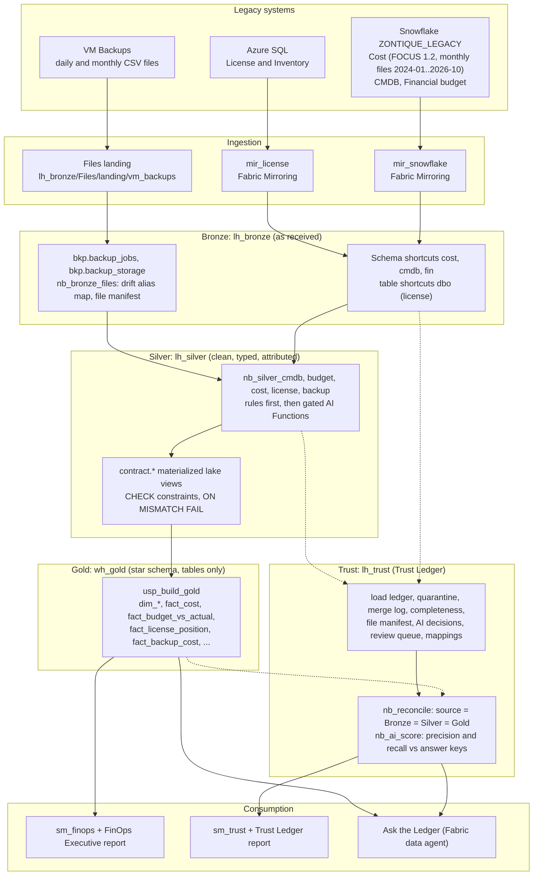

# Legacy Defuse Kit: architecture (current)

Team de_dust2. Zontique Corp's five legacy systems are consolidated in Microsoft Fabric, cleaned with rules and AI, and a Trust Ledger proves that nothing was lost. This page is the current design; `blueprint.md` and `sad.md` describe the earlier plan (storage accounts, Purview) and are kept for history.

## At a glance

Solid arrows carry data; dotted arrows are what each layer writes to the Trust Ledger.

## Layers and items

| Layer | Item | What it does |
|---|---|---|
| Legacy | Snowflake `ZONTIQUE_LEGACY` (`COST`, `CMDB`, `FIN`, `RPT`), Azure SQL `dbo`, Legacy Cost Report | The "before": flawed legacy views and a report that reads them directly |
| Ingestion | `mir_snowflake`, `mir_license` | Fabric Mirroring, near real time, no code |
| Bronze | `lh_bronze` | Data exactly as received (all text for Snowflake). Shortcuts to the mirrors; `nb_bronze_files` lands the VM Backup files |
| Silver | `lh_silver` + 5 notebooks | Typed, de-duplicated, attributed to application and cost center; every Bronze row ends in Silver, quarantine or the merge log |
| Contracts | `nb_silver_contract` | Materialized lake views that fail the run if a "ready for Gold" rule is broken |
| Gold | `wh_gold`, `usp_build_gold` | Star schema, rebuilt each run. Tables only (Direct Lake on OneLake can't read views) |
| Trust | `lh_trust`, `nb_reconcile`, `nb_ai_score`, `nb_ai_review`, `nb_profile_legacy` | The proof and the AI quality record |
| Orchestration | `pl_ldk_end_to_end` | `nb_orchestrator` (Bronze + Silver + contracts in one Spark session) → stored procedure `usp_build_gold` → `nb_reconcile` → `nb_ai_score` → refresh of both semantic models |

## How the five systems join

| From | To | Key |
|---|---|---|
| Cost line (Azure) | CMDB scope | resource group from `ResourceId` (lower case) = scope name |
| Cost line (Google Cloud) | CMDB scope | `SubAccountId` (project id) = scope name |
| CMDB scope | Application | application code inside the scope name (`rg-<code>-...`, `prj-<code>-...`); group mapping as fallback |
| Application | Budget | cost center (4 digits) |
| VM Backup job / storage | CMDB scope, cost | resource group from `VM_RESOURCE_ID`; VM name = `ResourceName` |
| License installation | Cost | `host_name` = VM `ResourceName` (cores, pay-as-you-go Windows charges) |

FOCUS rule: `EffectiveCost` for chargeback and budget comparison, `BilledCost` for the invoice.

## Where AI is used

Rules always run first. AI Functions (`ai.classify`, `ai.similarity`, model `gpt-5-mini`) only see the distinct values the rules could not resolve. The answer must be one of the allowed labels and pass a similarity gate; otherwise it goes to a review queue. Accepted mappings become rules for the next run.

| Notebook | Task | Allowed labels |
|---|---|---|
| `nb_silver_cost` | application tag value (name, typo) → application code | the CMDB application codes |
| `nb_silver_cost` | non-standard service name → FOCUS service | services already known in the data |
| `nb_silver_cmdb` | department variant → finance department | the budget's department names |
| `nb_silver_license` | discovery product name → licensed product | the 8 catalog products |
| `nb_profile_legacy` | column meaning, explanation of findings | free text, logged |

`nb_ai_score` compares the results with the answer keys (`answer-keys/`, scoring only) and writes precision, recall and F1 per task and per method (rule or AI).

## Trust Ledger tables (`lh_trust`, schema `dbo`)

| Table | One row per |
|---|---|
| `meta_load_ledger` | table written per run: rows in, out, quarantined, merged, amount |
| `meta_quarantine`, `meta_merge_log` | rejected row / merged duplicate, by Bronze `_row_hash` |
| `meta_file_manifest`, `meta_completeness` | delivered file / missing day, month or file |
| `meta_ai_decisions`, `meta_ai_review_queue`, `meta_ai_mappings` | AI decision / open review item / approved mapping |
| `meta_reconciliation`, `meta_trust_summary` | check (PASS, FAIL, PENDING) / entity per run |
| `meta_ai_scorecard`, `meta_defect_detection` | cleansing task score / planted defect type |
| `meta_profile_*` | profiled table, column, finding |

Rule for every Silver table: rows in = rows out + quarantined + merged, and every Bronze `_row_hash` is found in one of the three.

## Governance inside Fabric (no Purview)

| Need | How |
|---|---|
| Access | Workspace roles; reports shared through an app; row-level security in the semantic model |
| Personal data | Owner names and emails hashed in Silver; never sent to AI |
| Lineage | Fabric lineage view (items), materialized lake view lineage (tables), `_row_hash` (rows) |
| Data quality | Contract views, reconciliation, profiling Bronze vs Silver |
| Catalog | OneLake catalog, item descriptions, endorsement of the Gold model |
| Secrets | Azure Key Vault `kv-ldk-2446996`; nothing in notebooks or Git |
| Planned | Policy scan notebook (naming, descriptions, answer keys not read by Silver), semantic model best-practice check |

## Not built yet

`pl_ldk_end_to_end`, the semantic models `sm_finops` and `sm_trust`, the two reports, the data agent sources, the policy scan.
