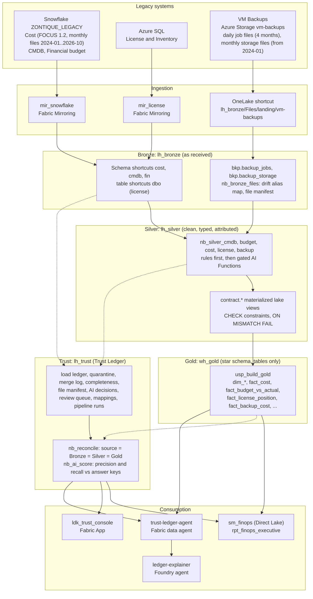

# Legacy Defuse Kit: architecture (current)

Team de_dust2. Zontique Corp's five legacy systems are consolidated in Microsoft Fabric, cleaned with rules and AI, and a Trust Ledger proves that nothing was lost. This page is the design as built. `blueprint.md` and `sad.md` are the plan we submitted and are kept for history; the differences are listed at the end of this page. Team guide in plain words: *Legacy Defuse Kit — How It Works* (shared doc).

## At a glance

Solid arrows carry data; dotted arrows are what each layer writes to the Trust Ledger. Rendered image: [diagrams/architecture.png](diagrams/architecture.png).

## Layers and items

| Layer | Item | What it does |
|---|---|---|
| Legacy | Snowflake `ZONTIQUE_LEGACY` (`COST`, `CMDB`, `FIN`, `RPT`), Azure SQL `dbo`, Legacy Cost Report | The "before": flawed legacy views and a report that reads them directly |
| Ingestion | `mir_snowflake`, `mir_license`, storage account `saodlepam2446996datalake` (container `vm-backups`) | Fabric Mirroring (no code) for the databases; OneLake shortcut for the backup files |
| Bronze | `lh_bronze` | Data exactly as received (all text for Snowflake). Shortcuts to the mirrors; a OneLake shortcut exposes the `vm-backups` storage container, and `nb_bronze_files` reads the files |
| Silver | `lh_silver` + 5 notebooks | Typed, de-duplicated, attributed to application and cost center; every Bronze row ends in Silver, quarantine or the merge log |
| Contracts | `nb_silver_contract` | Materialized lake views that fail the run if a "ready for Gold" rule is broken |
| Gold | `wh_gold`, `usp_build_gold` | Star schema, rebuilt each run. Tables only (Direct Lake on OneLake can't read views) |
| Trust | `lh_trust`, `nb_ledger_utils`, `nb_reconcile`, `nb_ai_score`, `nb_ai_review`, `nb_run_audit`, `env_ldk_reconcile` | The proof, the AI quality record and the pipeline run history |
| Legacy profiling | `nb_profile_legacy` | One-off profiling of the legacy data (not part of the daily run) |
| Orchestration | `one_pipeline_to_rule_them_all` (daily) | `nb_orchestrator` (Bronze + Silver + contracts in one Spark session) → `usp_build_gold` → `nb_reconcile` → `nb_ai_score` → `nb_run_audit` → `fail_run` if any step failed. No refresh step: `sm_finops` is Direct Lake |
| Consumption | `sm_finops`, `rpt_finops_executive`, `ldk_trust_console`, `trust-ledger-agent`, Foundry `ledger-explainer` | See *Consumption* below |

## How the five systems join

| From | To | Key |
|---|---|---|
| Cost line (Azure) | CMDB scope | resource group from `ResourceId` (lower case) = scope name |
| Cost line (Google Cloud) | CMDB scope | `SubAccountId` (project id) = scope name |
| CMDB scope | Application | application code inside the scope name (`rg-<code>-...`, `prj-<code>-...`); group mapping as fallback |
| Application | Budget | cost center (4 digits) |
| VM Backup job / storage | CMDB scope, cost | resource group from `VM_RESOURCE_ID`; VM name = `ResourceName` |
| License installation | Cost | `host_name` = VM `ResourceName` (cores, pay-as-you-go Windows charges) |

FOCUS rule: `EffectiveCost` for chargeback and budget comparison, `BilledCost` for the invoice.

## Where AI is used

Rules always run first. AI Functions (`ai.classify`, `ai.similarity`, model `gpt-5-mini`) only see the distinct values the rules could not resolve. The answer must be one of the allowed labels and pass a similarity gate; otherwise it is not used and goes to the review queue (`meta_ai_review_queue`), where a person approves or rejects it in `nb_ai_review`. Accepted mappings become rules for the next run.

| Notebook | Task | Allowed labels |
|---|---|---|
| `nb_silver_cost` | application tag value (name, typo) → application code | the CMDB application codes |
| `nb_silver_cost` | non-standard service name → FOCUS service | services already known in the data |
| `nb_silver_cmdb` | department variant → finance department | the budget's department names |
| `nb_silver_license` | discovery product name → licensed product | the 8 catalog products |
| `nb_profile_legacy` | column meaning, explanation of findings | free text, logged |

`nb_ai_score` compares the results with the answer keys (`answer-keys/`, scoring only) and writes precision, recall and F1 per task and per method (rule or AI).

## Trust Ledger tables (`lh_trust`, schema `dbo`)

| Table | One row per |
|---|---|
| `meta_load_ledger` | table written per run: rows in, out, quarantined, merged, amount |
| `meta_quarantine`, `meta_merge_log` | rejected row / merged duplicate, by Bronze `_row_hash` |
| `meta_file_manifest`, `meta_completeness` | delivered file / missing day, month or file |
| `meta_ai_decisions`, `meta_ai_review_queue`, `meta_ai_mappings` | AI decision (accepted, rejected, unmatched) / open review item / approved mapping |
| `meta_reconciliation`, `meta_trust_summary` | check (PASS, FAIL, PENDING) / entity per run |
| `meta_ai_scorecard`, `meta_defect_detection` | cleansing task score / planted defect type |
| `meta_pipeline_runs`, `meta_pipeline_activity_runs` | pipeline run / step per run (written by `nb_run_audit`) |
| `meta_profile_*` | profiled table, column, finding (one-off) |

Rule for every Silver table: rows in = rows out + quarantined + merged, and every Bronze `_row_hash` is found in one of the three.

## Consumption

| Item | Audience | Notes |
|---|---|---|
| `sm_finops` | All tools below | Direct Lake on OneLake over `wh_gold` (14 tables) and two `lh_trust` tables; 48 measures; picks up new data automatically |
| `rpt_finops_executive` | Finance, IT leads | 4 pages; trust banner on every page (Data Verified, Data As Of, Last Run Status) |
| `ldk_trust_console` | Data team | Fabric App (React, `apps/ldk_trust_console`): run history, step timeline, reconciliation, quality. Read-only, delegated auth: users see only what they can already read |
| `trust-ledger-agent` | Analysts | Fabric data agent over `wh_gold` and `lh_trust`, with instructions and example queries |
| `ledger-explainer` | Executives, auditors | Microsoft Foundry agent that calls `trust-ledger-agent` on behalf of the user (setup: `foundry-ledger-explainer.md`) |

## Governance

| Need | How |
|---|---|
| Access | Workspace roles; read-only, signed-in-user access for the app and both agents |
| Personal data | Owner names and emails hashed in Silver; never sent to AI |
| Lineage | Fabric lineage view (items), materialized lake view lineage (tables), `_row_hash` (rows), Purview |
| Data quality | Contract views, reconciliation, AI scorecard, run audit |
| Catalog | Microsoft Purview account `datatrace`: storage, Azure SQL, Snowflake and Fabric scans; the Snowflake scan role needs the read-only database role `SNOWFLAKE.OBJECT_VIEWER`. Unified Catalog domain *Legacy Defuse Kit* with glossary terms and data products |
| Labels | Sensitivity labels (Restricted, General), endorsements (Certified, Promoted), descriptions on every item |
| Secrets | Azure Key Vault `kv-ldk-2446996`; nothing in notebooks or Git |
| Change control | Fabric Git integration (`/fabric`); the app and docs live in the same repo |

## Blueprint vs as built

| Blueprint | As built | Why |
|---|---|---|
| Financial and License systems on a SQL Server VM behind a data gateway | Budget in Snowflake `FIN`; License in Azure SQL | Simpler and cheaper to run for the hackathon; Mirroring covers both |
| CMDB as a REST API on Azure Functions | CMDB in Snowflake `CMDB` | Same data and defects, no extra service to host |
| Copilot converts legacy T-SQL and SSIS, placement engine | Silver and Gold written by hand with AI help; legacy views kept in `RPT` as the "before" | Time; the Trust Ledger was the priority |
| Two semantic models and two reports | One model `sm_finops` and one report; the Fabric App covers pipeline health | Less to maintain, one source of truth |
| Copilot Studio assistant in Teams | Fabric data agent + Foundry agent | Available in our tenant |
| Purview DLP and data quality scans | Purview catalog scans, labels, endorsements | DLP not needed for synthetic data |
