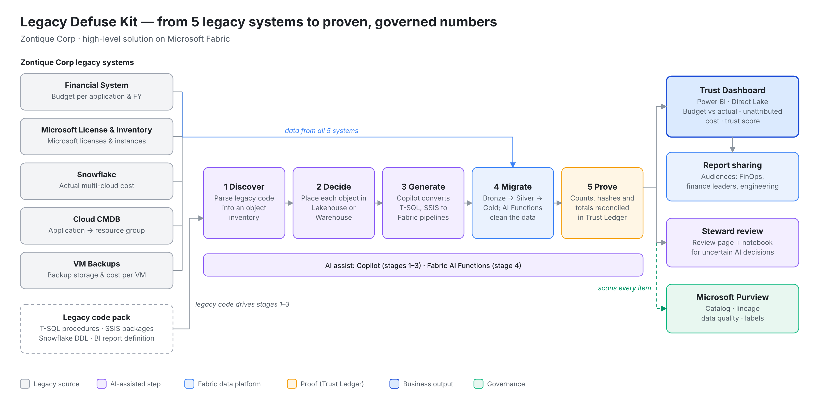
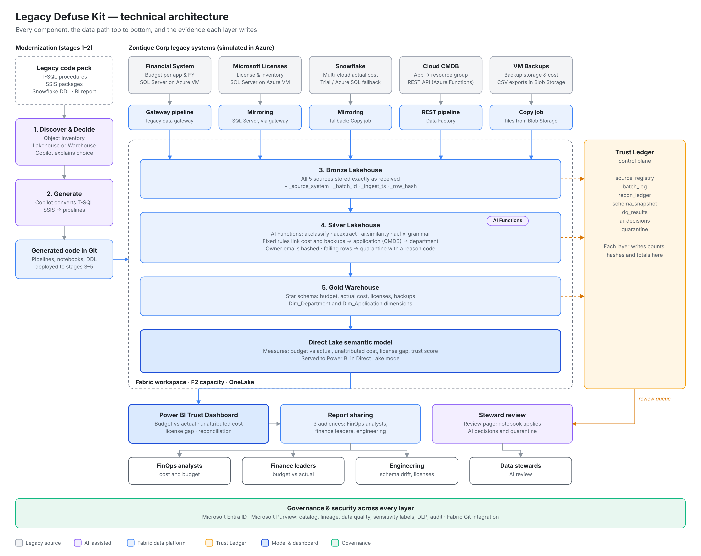
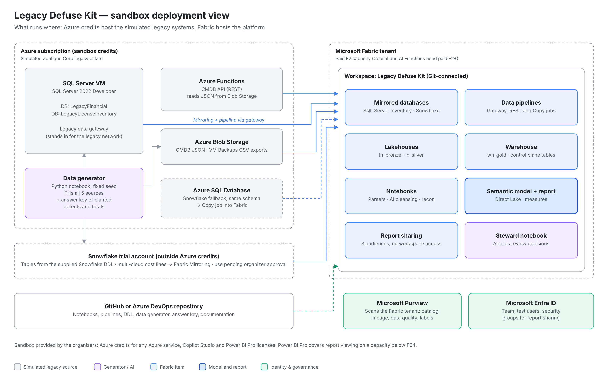
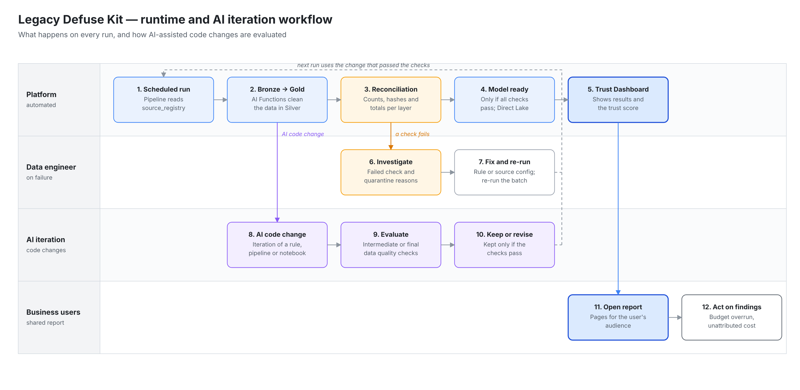
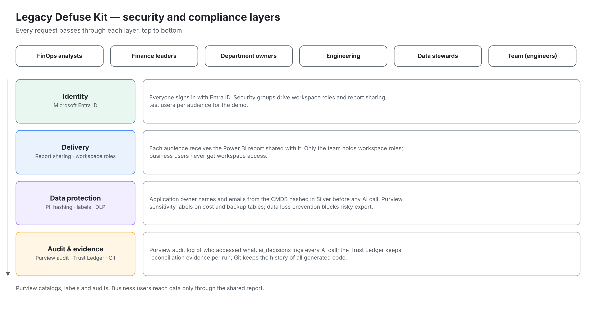
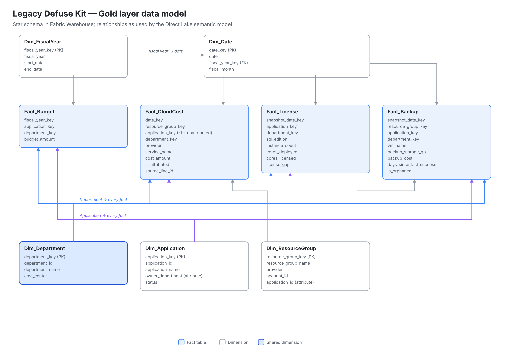

# Legacy Defuse Kit — AI-Accelerated Legacy-to-Fabric Modernization Factory

| | |
|---|---|
| **Idea name** | Legacy Defuse Kit |
| **Team** | de_dust2 (2 data engineers, 1 BI analyst) |
| **Challenge** | AI-Accelerated Legacy-to-Fabric Modernization Factory (Advanced, cross-industry) |
| **Target industry** | Cross-industry, demonstrated on Cloud FinOps (cost governance across teams and vendors) |
| **Scenario company** | Zontique Corp |
| **Version** | Blueprint v6 · 16 Oct 2026 |

**One line:** Legacy Defuse Kit moves Zontique Corp's cost data out of 5 legacy systems into a governed Microsoft Fabric Lakehouse, cleans it with AI, delivers it through a shared Power BI report, and proves with evidence that nothing was lost on the way.

---

## 1. Team & Challenge Statement

### Problem Statement / Business Challenge

Zontique Corp tracks cloud and IT spend across five legacy systems that were never designed to work together. Today they are stitched together by hand-written T-SQL procedures, SSIS packages and a spreadsheet-style BI report:

| # | Legacy system Integration| Holds | Issue today |
|---|---|---|---|
| 1 | Financial System | Budget per application and fiscal year | Budget can't be compared with actual spend per application or fiscal year without manual spreadsheet work |
| 2 | Microsoft License & Inventory System | Microsoft licenses and installed instances | License counts drift away from what is actually deployed, risking overspend and audit findings |
| 3 | Snowflake | Actual cost from one or more cloud providers | Cost lines with duplicates and inconsistent names can't be tied to an application or compared with budget |
| 4 | Cloud CMDB | Which application owns which cloud resource group | The mapping is stale and never joined in systematically, so part of the cloud bill has no owning application |
| 5 | VM Backups | Backup jobs, backup storage and backup cost per virtual machine | Backup storage keeps costing money for VMs that no longer exist, and some production VMs have no recent successful backup |

Across all five systems: chargeback numbers disagree across tools, with no lineage from source to the figure finance presents.

**Result:** finance and engineering leadership no longer trust the numbers, and can't answer "what does this application actually cost?".

### Proposed Solution

**Legacy Defuse Kit** is a Microsoft Fabric-native modernization factory. It takes the legacy code that connects the 5 systems today (T-SQL procedures, SSIS packages, Snowflake DDL, BI report definition), rebuilds it as a governed Medallion Lakehouse, and proves that the migrated numbers match the source.

The solution combines:

- **AI-assisted discovery and code conversion** — Copilot converts legacy T-SQL and SSIS logic
- **AI data cleansing** — Fabric AI Functions standardize names, extract fields from free text and flag likely duplicates, with every AI decision logged
- **Trust Ledger** — row counts, row hashes and control totals reconciled at every layer, so every row is loaded, quarantined or merged, never silently dropped
- **Governed delivery** — Microsoft Purview for catalog, lineage and data quality; a Power BI Trust Dashboard shared directly with each audience

It runs in five stages: **Discover → Decide → Generate → Migrate → Prove**.

### Target Users / Beneficiaries

- FinOps and cloud cost management teams
- CFO and finance leaders who need budget-vs-actual and chargeback numbers they can defend
- Engineering and platform teams accountable for cloud, backup and Microsoft license spend
- Department and cost-center owners who need self-service access to trusted cost and budget numbers
- Data governance and compliance teams (audit trail, lineage)
- Data engineers modernizing legacy ETL and warehouse estates

### Real-World Application

The platform can detect and explain scenarios like:

- An application whose actual cloud spend overruns its budget mid-fiscal-year, caught early instead of at quarter close
- Cloud cost that no application owns, because the CMDB mapping is stale or incomplete
- Microsoft software installations exceeding licensed capacity, found before an audit rather than during one
- Backup storage still billed for deleted VMs (orphaned backups), and production VMs with no recent successful backup
- An application that moves to another department, with its cost history re-attributed and reconciled

### Future Extensibility (Post-Hackathon Roadmap)

- Direct ingestion of cloud billing exports (Azure Cost Management, AWS, GCP) next to Snowflake
- Cost normalization to the FinOps Foundation's FOCUS specification, so new providers plug into one chargeback model
- Real-time spend anomaly alerts with Fabric Eventhouse and Data Activator
- A FinOps assistant in Microsoft Teams (Copilot Studio over a Fabric data agent): "did anything get lost in last night's reconciliation?"
- Signed migration certificates per cost metric, generated from the Trust Ledger

---

## 2. Microsoft Technology / Services Touched

**Cloud & Data Platform**
- Microsoft Fabric (paid F2 capacity)
- Fabric Lakehouse (Bronze / Silver / Gold)
- Fabric Warehouse
- OneLake
- Fabric Data Factory (pipelines, Copy job)
- Fabric Mirroring (SQL Server, Snowflake)
- Legacy data gateway

**AI / GenAI**
- Copilot in Fabric
- Fabric AI Functions
- Copilot Studio (stretch goal)

**Legacy Source Simulation (Azure)**
- SQL Server on Azure Virtual Machines
- Azure Functions (CMDB REST API)
- Azure Blob Storage (CMDB data, VM Backups exports)
- Azure SQL Database (Snowflake fallback)
- Azure Key Vault (secrets)

**Security / Governance / Compliance**
- Microsoft Entra ID (sign-in and workspace roles)
- Microsoft Purview (Unified Catalog, lineage, data quality, sensitivity labels, DLP, audit)

**Visualization & Reporting**
- Power BI (Direct Lake semantic model)
- Power BI report sharing (no workspace access for viewers)

**DevOps**
- Fabric Git integration (GitHub or Azure DevOps)

---

## 3. Business Impact

### Market Relevance

Cloud spend is now a major line in most IT budgets, yet the data needed to govern it (budgets, actual cost, asset ownership, org structure) usually sits in separate systems. FinOps practices depend on allocating every cost to an owner. Many enterprises also carry legacy ETL estates like Zontique's, so a provable path from legacy to Fabric applies well beyond FinOps.

### Business Benefits

- Restored trust in cost numbers through auditable, row-level reconciliation
- Every cloud cost attributed to an application and department, or flagged
- Earlier detection of budget overruns and license gaps
- Orphaned backup storage found and reclaimed
- Less manual reporting effort for FinOps analysts
- Self-service cost and budget views for department owners

### Performance & Operational Value

- AI-assisted conversion of legacy T-SQL and SSIS logic
- AI-assisted standardization and deduplication of cost records
- Automatic schema-drift detection between runs
- Explainable placement decisions (Lakehouse vs Warehouse) written by Copilot

### Security & Trust

- Append-only reconciliation evidence for every run
- Item-level lineage in Purview, plus row-level tracing to each source in the Trust Ledger
- Every AI decision logged (input, output, model, timestamp)
- Owner contact details hashed before AI processing

### Expected Outcomes

- 100% of migrated rows accounted for: loaded, quarantined or merged
- Measured AI cleansing precision and recall against a known answer key
- Every dollar of actual cost attributed to an application, or listed as unattributed
- Every backup attributed to an application, with orphaned backups and unprotected VMs listed
- A Trust Dashboard that turns "trust me" into "here is the proof"

---

## 4. Technical Architecture

### Architecture Overview

- The 5 legacy systems are simulated in Azure with generated data containing planted defects: the two legacy databases on a SQL Server VM, Snowflake (or an Azure SQL fallback), a REST API on Azure Functions for the CMDB, and daily VM Backups CSV exports in Azure Blob Storage.
- **Discover & Decide:** a PySpark notebook parses the legacy T-SQL, SSIS, Snowflake DDL and report definition into an object inventory. A placement engine assigns each object to Lakehouse or Warehouse, and Copilot explains each choice.
- **Generate:** Copilot converts the T-SQL procedures into Fabric Warehouse T-SQL; SSIS logic becomes Fabric pipelines and notebooks; all generated code is committed to Git.
- **Bronze:** each source lands through its own route: Mirroring for SQL Server and Snowflake, a gateway pipeline for the Financial System, a REST pipeline for the CMDB and a Copy job for the VM Backups files. Rows are stored as received, with a row hash.
- **Silver:** Fabric AI Functions clean names and free text; fixed rules link cost and backups to applications (CMDB) and applications to departments. Owner names and emails are hashed. Failing rows go to quarantine with a reason code.
- **Gold:** a star schema in Fabric Warehouse (budget, actual cost, licenses, backups) with a Direct Lake semantic model on top.
- **Prove:** every stage writes counts, hashes and control totals to the Trust Ledger. Purview catalogs every item, shows lineage and runs data quality scans.
- **AI iteration:** code changes made with AI help (converted procedures, pipelines, cleansing rules) are made in iterations; each is evaluated against intermediate (Bronze, Silver) or final (Gold) data quality checks before it is kept.
- **Consume:** the Power BI Trust Dashboard is shared directly with each audience.

### Core Components

| Layer | Component | Function |
|---|---|---|
| 1. Discovery & Decision | PySpark parsers, placement engine, Copilot | Inventory of legacy objects, target placement, migration roadmap |
| 2. Generation | Copilot, Git | Convert T-SQL and SSIS logic into Fabric pipelines, notebooks and DDL |
| 3. Ingestion (Bronze) | Mirroring, Data Factory, legacy data gateway | Land all 5 sources as received, with row hashes |
| 4. Cleansing (Silver) | Fabric AI Functions, PySpark | Standardize, deduplicate, hash personal data, link cost to owners |
| 5. Modeling (Gold) | Fabric Warehouse, Direct Lake semantic model | Star schema for budget, actual cost, licenses and backups |
| 6. Proof & Governance | Trust Ledger tables, Microsoft Purview | Reconciliation, schema drift, AI audit log, catalog, lineage, data quality |
| 7. Consumption | Power BI | Trust Dashboard per audience |

### Security & Compliance

- Microsoft Entra ID for sign-in and workspace roles; nobody outside the team gets workspace access
- The report is shared per group; business users get report access only, never workspace access
- Personal data (application owner names and emails from the CMDB) hashed in Silver before any AI processing
- Purview sensitivity labels on cost and backup tables, data loss prevention and audit logging
- Every AI Function call logged to an audit table, since the functions themselves keep no record
- Git history and rollback for all generated pipelines, notebooks and DDL

### Delivery Plan (2 Weeks)

| Days | Work | Owner |
|---|---|---|
| 1–2 | Provision Fabric, Purview and simulated sources; generate data and answer key | All |
| 3–4 | Discover & Decide: inventory, placement, roadmap | Data Engineer 2 |
| 5–6 | Generate & Bronze: code conversion, ingestion of all 5 sources | Data Engineers 1 and 2 |
| 7–8 | Silver: AI cleansing, CMDB joins, backup attribution, quarantine | Data Engineers 1 and 2 |
| 9–10 | Gold, semantic model, Purview scans | Data Engineer 1, BI Analyst |
| 11–12 | Trust Dashboard, report sharing | BI Analyst, Data Engineer 2 |
| 13–14 | Hardening, documentation, pitch video | All |

### Diagrams

### Supporting Documents (attached)

- `Legacy_Defuse_Kit_SAD.pdf` — Software Architecture Document
